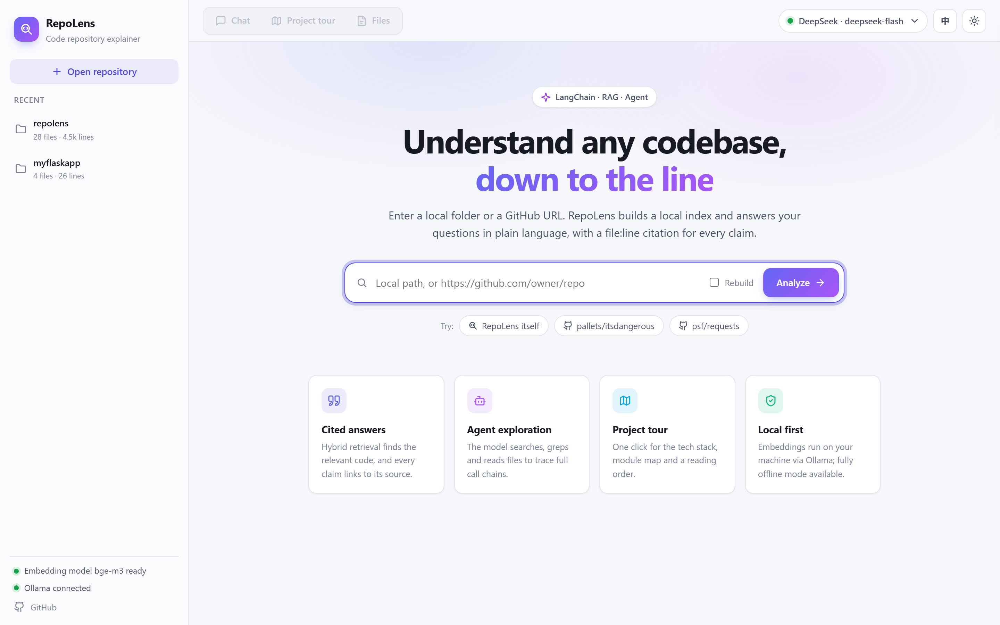
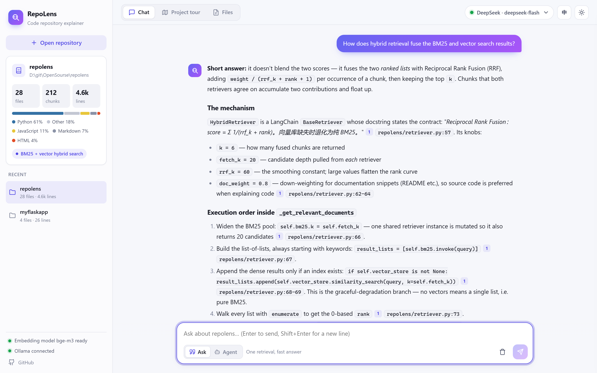
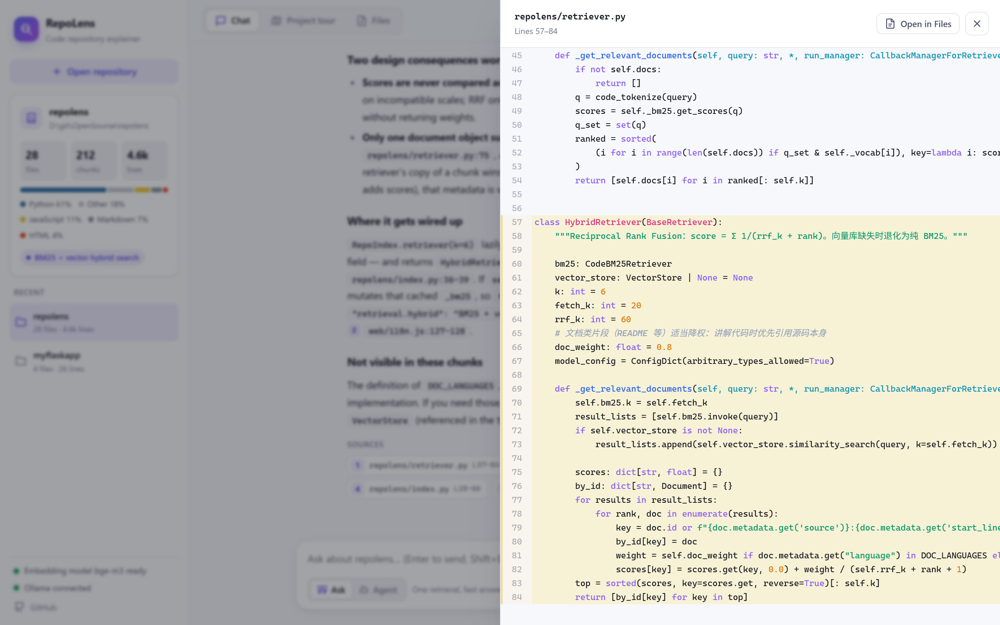
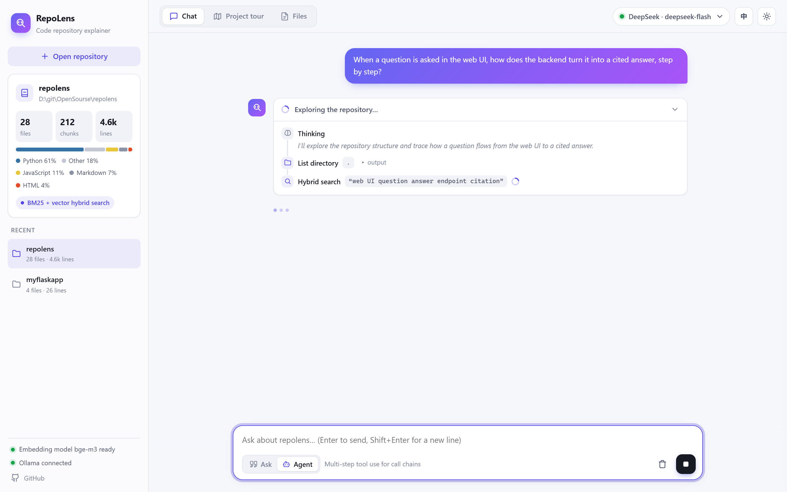
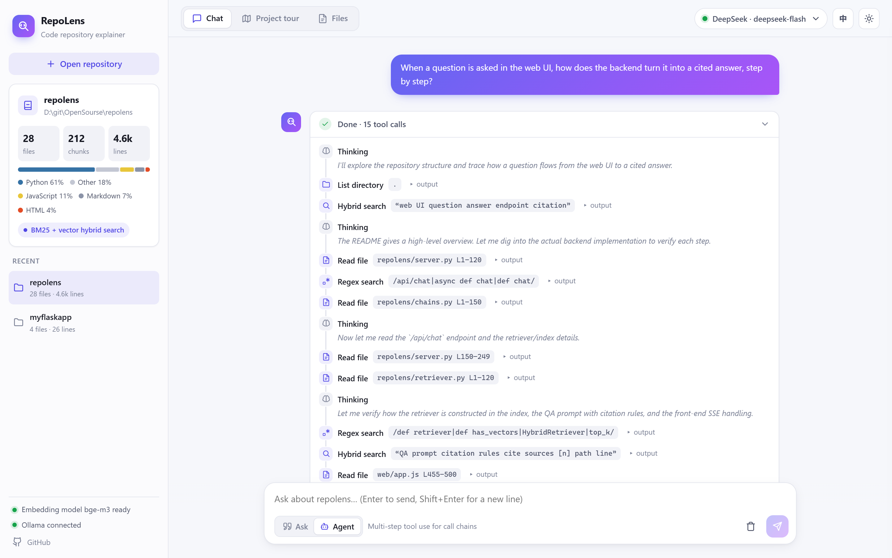
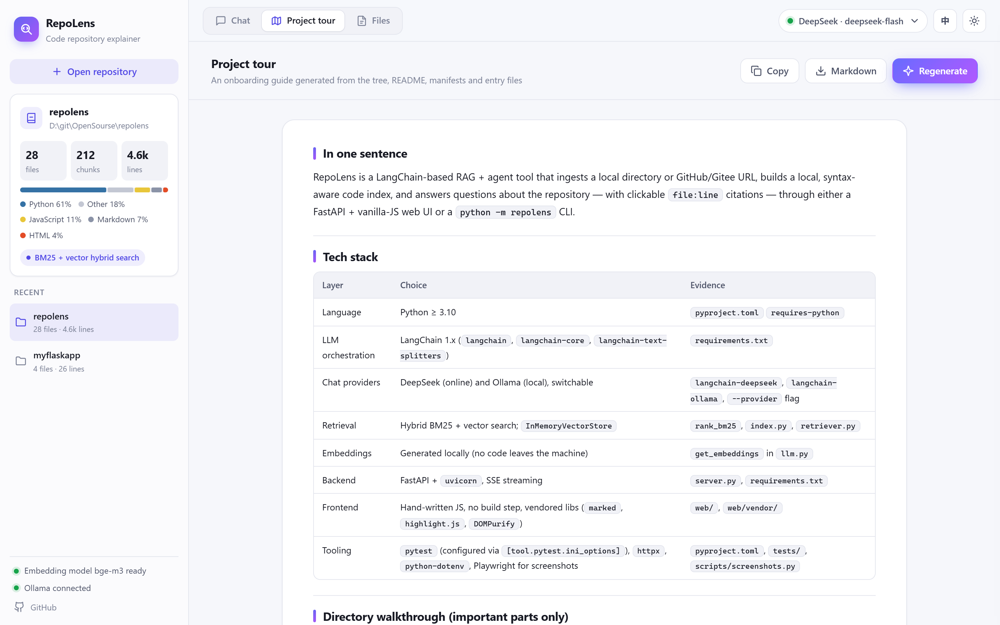
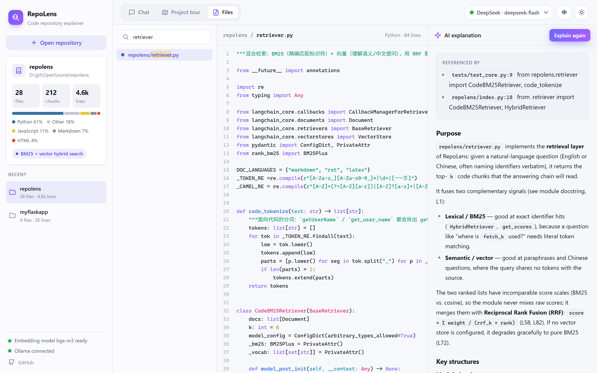
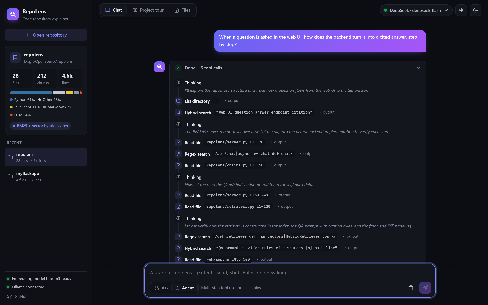
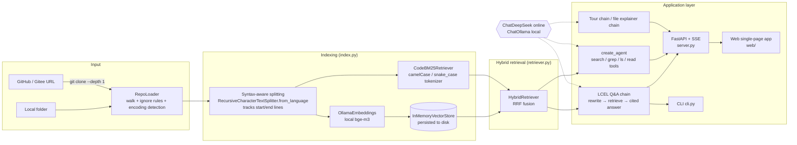

<div align="center">

# 🔭 RepoLens · Code Repository Explainer

**Point it at a local folder or a GitHub URL. It reads the whole repository, answers your questions, and cites the exact `file:line`.**

Built on **LangChain 1.x** · switch between online **DeepSeek** and local **Ollama** in one click · bilingual UI · code embeddings computed entirely on your machine


[简体中文](README.md) | **English**



</div>

---

## 📌 Contents

- [Why RepoLens](#-why-repolens)
- [Features](#-features)
- [Demo](#-demo)
- [Architecture](#-architecture)
- [How LangChain Is Used](#-how-langchain-is-used)
- [Quick Start](#-quick-start)
- [Usage](#-usage)
- [Project Layout](#-project-layout)
- [Design Notes](#-design-notes)
- [Testing](#-testing)
- [Limitations and Roadmap](#-limitations-and-roadmap)

## 💡 Why RepoLens

When you join a team, pick up an open-source project, or review a classmate's assignment, the hard part is usually not writing code. It is **understanding someone else's code**:

- You don't know where the entry point is or how the modules call each other.
- Finding "where login is handled" means a global search and opening files one by one.
- Pasting the code into a chatbot? The repo is too big to fit, and the model tends to **make up code that doesn't exist**.

RepoLens tackles this with **RAG (retrieval-augmented generation) + an agent**. It splits the repository along syntax boundaries and builds a local index. The model then answers **only from the real code it retrieved**, and every claim links to a source you can click and check.

## ✨ Features

| Feature | Description |
| --- | --- |
| 💬 **Cited Q&A** | Hybrid BM25 + vector retrieval finds the most relevant code. Every `[n]` and `path:line` in an answer is clickable and opens the source in a side drawer with the cited lines highlighted. Follow-up questions are rewritten automatically using the chat history |
| 🤖 **Agent exploration** | The model calls four tools on its own (`search_code`, `grep_code`, `list_directory`, `read_file`) to trace call chains over several steps. A live timeline shows each step, and the final answer streams token by token |
| 🗺️ **Project tour** | Reads the directory tree, README, dependency manifests and entry files, then writes an onboarding guide: tech stack, directory walkthrough, module table, how to run it, and a suggested reading order. Copy it or export it as Markdown |
| 📄 **File explainer** | A searchable file tree plus a syntax-highlighted, line-numbered code view. Get a function-by-function explanation and see where the file is referenced |
| 🔀 **Online / offline** | Switch at any time between online DeepSeek (better quality, faster) and local Ollama (fully offline, private) |
| 🌐 **Bilingual · light & dark** | Switch the UI and the answer language between Chinese and English in one click; light and dark themes; chats, tours and explanations are saved in the browser |
| ⚡ **Incremental cache** | The index is cached by a file fingerprint, so an unchanged repo loads in seconds. GitHub / Gitee repos are shallow-cloned automatically; recent repos are one click away |
| 🖥️ **Web + CLI** | A FastAPI backend with SSE streaming and a vanilla-JS single-page frontend (no build step; libraries are bundled, so it works offline), plus a `python -m repolens` command-line tool |

## 🎬 Demo

> These screenshots are generated by [`scripts/screenshots.py`](scripts/screenshots.py), which drives a real browser with Playwright. RepoLens is explaining its own source code, with DeepSeek as the chat model and local Ollama `bge-m3` for embeddings.

**💬 Cited Q&A**: the `[n]` markers, `path:line` references and source cards are all clickable.



**📎 Click a citation**: a side drawer opens the source with the cited lines highlighted, and can jump to the Files view.



**🤖 Agent exploration**: the timeline shows each tool call; expand one to see its output, or click a `read_file` argument to open that code.

| Exploring (live) | Done |
| --- | --- |
|  |  |

**🗺️ Project tour** and **📄 File explainer**

| Project tour | File explainer |
| --- | --- |
|  |  |

**🌙 Dark theme**



## 🏗️ Architecture



**What happens for one question:**

```
question ──► (if there is history) rewrite into a standalone query ──► BM25 top 20   ┐
                                                                      vector top 20 ┴─► RRF fusion, keep top 6 (docs slightly down-weighted)
         ──► format as "[n] path (Lx-Ly) + code" ──► QA prompt ──► streamed LLM output
         ──► SSE events: query → sources → token… → done ──► the UI renders the answer, citation markers and source cards
```

## 🦜 How LangChain Is Used

| LangChain feature | How RepoLens uses it | Where |
| --- | --- | --- |
| `Document` | Carries file content plus metadata (path, language, start/end lines) | `loader.py` |
| `RecursiveCharacterTextSplitter.from_language` | Splits along class and function boundaries for 20+ languages (Python, JS, Go, Java, …) | `splitter.py` |
| `Embeddings` (`OllamaEmbeddings`) | Local bge-m3 embeddings; source code never leaves the machine | `llm.py` |
| `InMemoryVectorStore` | Vector store, persisted to disk with `dump` / `load` | `index.py` |
| Custom `BaseRetriever` | `CodeBM25Retriever` (code-aware BM25) + `HybridRetriever` (RRF fusion) | `retriever.py` |
| `ChatPromptTemplate` + `MessagesPlaceholder` | Prompt templates for Q&A, query rewriting, project tour and file explainer, one set each for Chinese and English, with multi-turn history | `prompts.py` |
| **LCEL** (`prompt \| llm \| parser`) | Composes the four chains and streams them with `.stream()` | `chains.py` |
| `ChatDeepSeek` / `ChatOllama` | One interface for online and local models, chosen per request | `llm.py` |
| `@tool` | Four repo-exploration tools with path-traversal protection | `agent.py` |
| `create_agent` (LangChain 1.x, built on LangGraph) | ReAct-style tool-calling agent; subscribes to both the `messages` and `updates` streams, so tool calls show live and the answer streams token by token | `agent.py` |
| `FakeListChatModel` / `DeterministicFakeEmbedding` | Stand in for real models in unit tests, so tests need no network | `tests/` |

## 🚀 Quick Start

### 1. Requirements

- Python 3.10+
- Git (for cloning remote repositories)
- [Ollama](https://ollama.com/) for local embeddings. Optional: without it, RepoLens falls back to BM25-only retrieval
- A DeepSeek API key if you use the online model ([get one here](https://platform.deepseek.com/api_keys))

### 2. Install

```bash
git clone https://github.com/Red-Sa1t/repolens.git
cd repolens
python -m venv .venv
# Windows
.venv\Scripts\activate
# macOS / Linux
source .venv/bin/activate
pip install -r requirements.txt
```

### 3. Pull the models

```bash
# Local embedding model (works well for Chinese, English and code; about 1.2 GB)
ollama pull bge-m3

# For fully offline chat, also pull a chat model that supports tool calling
ollama pull qwen2.5:7b
```

### 4. Configure

```bash
cp .env.example .env
```

Edit `.env` and set `DEEPSEEK_API_KEY`. You can also skip `.env` and enter the key in the model settings (top right of the web UI); it is stored in your browser only.

| Variable | Default | Description |
| --- | --- | --- |
| `REPOLENS_PROVIDER` | `deepseek` | Default chat model provider: `deepseek` or `ollama` |
| `DEEPSEEK_API_KEY` | — | DeepSeek API key |
| `DEEPSEEK_MODEL` | `deepseek-chat` | `deepseek-reasoner` and others also work |
| `OLLAMA_BASE_URL` | `http://localhost:11434` | Ollama server address |
| `OLLAMA_MODEL` | `llama3.2` | Local chat model |
| `REPOLENS_EMBED_MODEL` | `bge-m3` | Local embedding model |

### 5. Run

```bash
python -m repolens serve
```

Open <http://127.0.0.1:8000>, enter a repo path or GitHub URL, and click **Analyze**. No repo handy? Click **RepoLens itself** and it will explain its own code.

## 🧭 Usage

### Web UI

- **Chat**: switch between **Ask** and **Agent** below the input box.
  - Ask suits "where is X / what is X". One retrieval, answer in seconds.
  - Agent suits "what is the full call chain / which files do I touch to change this feature". The model searches and reads files on its own, several times.
  - Click `[1]`, a `path:line` reference or a source card in an answer to open the code in the side drawer with the lines highlighted.
  - `Enter` sends, `Shift+Enter` adds a new line, and you can stop generation at any time.
- **Project tour**: click **Generate tour**; copy the result or export it as Markdown.
- **Files**: search and pick a file on the left, read the highlighted source in the middle, and click **Explain file** on the right.
- **Top right**: switch the model (DeepSeek / Ollama), the language (中 / EN; answers follow the UI language), and the light/dark theme.

### CLI

```bash
# Build or refresh the index
python -m repolens index ./some-project

# Ask a question (retrieval Q&A); --lang en for English answers
python -m repolens --lang en ask ./some-project "Where is the login logic?"

# Ask in agent mode
python -m repolens --lang en ask https://github.com/pallets/flask "Which functions does a request pass through from arrival to response?" --agent

# Generate a project tour / explain a file
python -m repolens --lang en overview ./some-project
python -m repolens --lang en explain ./some-project src/app.py

# Interactive multi-turn chat; --provider switches the model for this run
python -m repolens --provider ollama --model qwen2.5:7b chat ./some-project
```

## 📁 Project Layout

```
repolens/
├── repolens/
│   ├── config.py          # Settings (.env → Settings)
│   ├── llm.py             # Model factory: ChatDeepSeek / ChatOllama / OllamaEmbeddings
│   ├── loader.py          # Repo loading: local/remote, ignore rules, encoding detection, directory tree
│   ├── splitter.py        # Syntax-aware splitting + line tracking
│   ├── retriever.py       # Code-aware BM25 retriever + RRF hybrid retriever
│   ├── index.py           # Index building, fingerprint cache, persistence
│   ├── prompts.py         # Chinese and English prompt templates
│   ├── chains.py          # LCEL chains: Q&A / project tour / file explainer
│   ├── agent.py           # Tool definitions + create_agent (token streaming)
│   ├── server.py          # FastAPI backend: REST + SSE streaming
│   └── cli.py             # Command-line entry point (including serve)
├── web/                   # Single-page frontend (no build step)
│   ├── index.html
│   ├── app.css            # Design tokens + light/dark themes
│   ├── app.js             # Views, streaming rendering, citation links, file tree
│   ├── i18n.js            # Chinese and English UI strings
│   ├── icons.js           # Line icons
│   └── vendor/            # marked / DOMPurify / highlight.js (bundled, works offline)
├── scripts/screenshots.py # Automated screenshots with Playwright
├── tests/                 # pytest: core modules + API (no network or real models needed)
├── docs/images/           # README screenshots (zh / en)
├── requirements.txt
└── .env.example
```

**Backend API:**

| Endpoint | Description |
| --- | --- |
| `GET /api/settings` | Current model settings and Ollama / embedding status |
| `GET /api/recent` | Recently opened repositories |
| `POST /api/index` | Build or load an index (SSE: `progress` → `repo`) |
| `GET /api/repos/{id}` / `GET /api/repos/{id}/file` | Repo info and file list / read a file (with path-traversal checks) |
| `POST /api/chat` | Q&A (SSE: `query`, `sources`, `token`; agent mode adds `tool_call`, `tool_result`, `answer`) |
| `POST /api/overview` / `POST /api/explain` | Project tour / file explainer (SSE: `token`; the explainer adds `references`) |

## 🔬 Design Notes

**1. Why hybrid retrieval instead of vectors alone?**
Code search has two kinds of queries. Some describe behavior in natural language ("where payment callbacks are handled"), which needs **semantic search**. Others name an identifier directly (`check_password`), where an embedding model is less precise than **keyword matching**. RepoLens runs both and merges them with **RRF (Reciprocal Rank Fusion)**, which works on ranks, so there are no score weights to tune. Documentation chunks such as the README get a 0.8 weight in fusion, so explanations cite the source code itself first.

**2. A code-aware tokenizer.**
The BM25 tokenizer splits `getUserName` and `get_user_name` into `get / user / name` while also keeping the whole identifier, so searching "user name" still finds camelCase functions. It uses `BM25Plus` rather than `BM25Okapi`: in tiny repos with only a few files, Okapi's IDF can drop to zero and nothing matches.

**3. Clickable citations down to the line.**
Splitting runs with `add_start_index`, and each chunk's character offset is converted into start and end line numbers. The frontend detects `[n]` markers and inline code like `path:line` in answers, maps them to real files in the repo, and opens the source in a drawer with those lines highlighted.

**4. Streaming experience.**
Every generation endpoint is an SSE event stream. The frontend batches rendering with `requestAnimationFrame` so it doesn't re-layout on every token. In agent mode, RepoLens subscribes to both LangGraph streams: `messages` (tokens) and `updates` (tool calls). Text the model says before a tool call becomes a "thinking" step, and the final answer streams token by token.

**5. Privacy and offline use.**
Embeddings always run on local Ollama, so **the full source is never sent to any embedding service**. Only the few retrieved chunks go to the chat model. Frontend libraries are bundled in `web/vendor/` instead of loaded from a CDN. If you pick Ollama for chat as well, the whole pipeline runs offline.

**6. Agent safety limits.**
`read_file`, `list_directory` and the file API resolve every path and check that it stays inside the repo root, which blocks reads like `../../etc/passwd`. Tool output is capped in length, and the agent has a maximum step count (`recursion_limit`) to prevent context blow-up and endless loops.

**7. Incremental cache and graceful fallback.**
The fingerprint covers each file's relative path, size and modification time, plus the embedding model name and the splitting parameters, so an unchanged repo loads straight from the cache. If Ollama isn't running or the embedding model hasn't been pulled (checked first through an endpoint with a timeout, so requests never hang), RepoLens falls back to BM25-only retrieval and the UI shows the current mode. If the backend restarts, the frontend reloads the repo from the cache and retries the request automatically.

## 🧪 Testing

```bash
pytest -q
```

The tests use LangChain's built-in `FakeListChatModel` and `DeterministicFakeEmbedding`, so **they need no network and no API key**. The 16 tests cover:

- The code tokenizer, remote-URL detection, and ignore rules (`node_modules`, binary files, `.gitignore`)
- Correct line numbers after splitting
- Index building, cache hits, automatic rebuild after a file changes, and the fallback without an embedding model
- Output of the four agent tools, and path-traversal protection
- An end-to-end Q&A chain call and reference lookup
- The FastAPI endpoints: index progress events, file reads and traversal blocking, the SSE streams for Q&A / tour / explainer, and the static frontend

## 🧱 Limitations and Roadmap

- [ ] Very large repos (> 3000 files) are capped at the first 3000 files; per-directory indexing is planned
- [ ] Parse symbol tables with tree-sitter to support "go to definition / find all callers"
- [ ] Generate module dependency graphs (Mermaid)
- [ ] Support persistent vector stores such as Chroma or Milvus, and searching across several repos at once
- [ ] Small local models (around 3B or less) plan poorly in agent mode; DeepSeek or Qwen2.5 7B+ is recommended

## 📄 License

[MIT](LICENSE)
