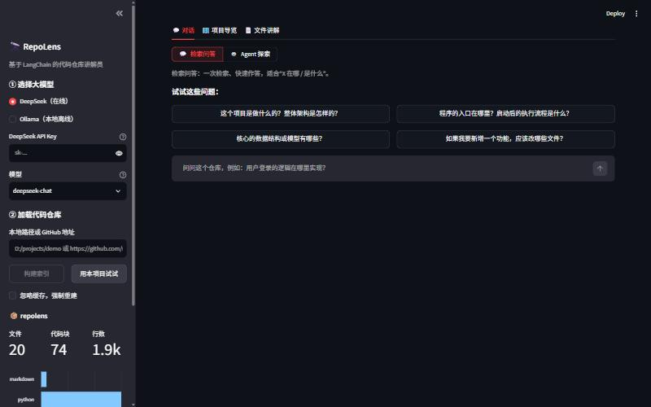
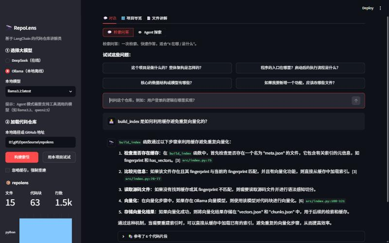
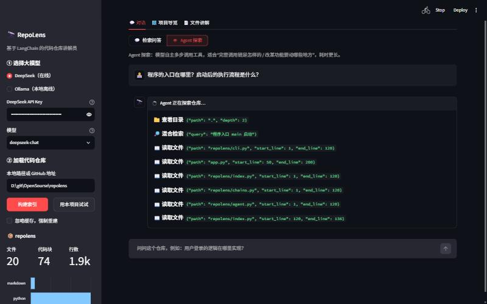
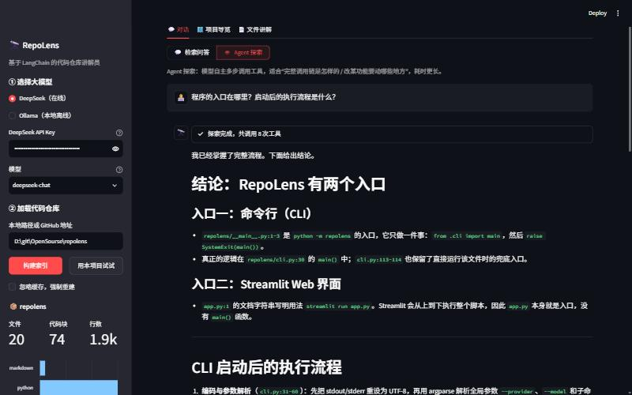
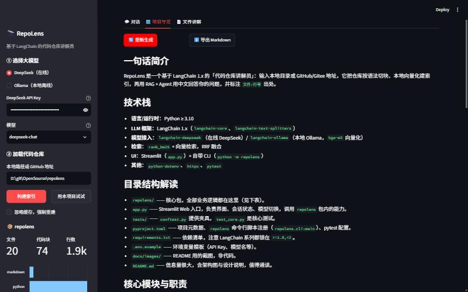
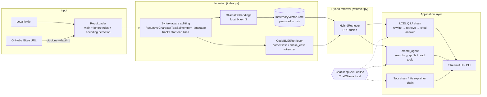

<div align="center">

# 🔭 RepoLens · Code Repository Explainer

**Point it at a local folder or a GitHub URL. It reads the whole repository, answers your questions, and cites the exact `file:line`.**

Built on **LangChain 1.x** · switch between online **DeepSeek** and local **Ollama** in one click · code embeddings are computed entirely on your machine


[简体中文](README.md) | **English**

</div>

---

## 📌 Contents

- [Why RepoLens](#-why-repolens)
- [Features](#-features)
- [Demo](#-demo)
- [Architecture](#-architecture)
- [How LangChain Is Used](#-how-langchain-is-used)
- [Quick Start](#-quick-start)
- [Usage](#-usage)
- [Project Layout](#-project-layout)
- [Design Notes](#-design-notes)
- [Testing](#-testing)
- [Limitations and Roadmap](#-limitations-and-roadmap)

## 💡 Why RepoLens

When you join a team, pick up an open-source project, or review a classmate's assignment, the hard part is usually not writing code. It is **understanding someone else's code**:

- You don't know where the entry point is or how the modules call each other.
- Finding "where login is handled" means a global search and opening files one by one.
- Pasting the code into a chatbot? The repo is too big to fit, and the model tends to **make up code that doesn't exist**.

RepoLens tackles this with **RAG (retrieval-augmented generation) + an agent**. It splits the repository along syntax boundaries and builds a local index. The model then answers **only from the real code it retrieved**, and every claim comes with a source you can check.

> **Language note:** the prompts are written for Chinese-speaking users, so answers come back in Simplified Chinese by default. To get English answers, change the language instruction in `repolens/prompts.py` (`SYSTEM_BASE`, `QA_PROMPT` and `AGENT_SYSTEM`).

## ✨ Features

| Feature | Description |
| --- | --- |
| 💬 **Cited Q&A** | Hybrid BM25 + vector retrieval finds the most relevant code chunks. Answers are tagged with `[n] path:line`, and you can expand each source to check it. Follow-up questions are rewritten automatically using the chat history |
| 🤖 **Agent exploration** | The model calls four tools on its own (`search_code`, `grep_code`, `list_directory`, `read_file`) to trace call chains over several steps. The UI shows every step live |
| 🗺️ **Project tour** | Reads the directory tree, README, dependency manifests and entry files, then writes an onboarding guide: tech stack, directory walkthrough, module responsibility table, how to run it, and a suggested reading order. Exportable as Markdown |
| 📄 **File explainer** | View any file with line numbers, get a function-by-function explanation, and see where it is referenced elsewhere in the repo |
| 🔀 **Online / offline** | Switch at any time between online DeepSeek (better quality, faster) and local Ollama (fully offline, private) |
| ⚡ **Incremental cache** | The index is cached by a file fingerprint, so an unchanged repo loads in seconds. GitHub / Gitee repos are shallow-cloned automatically |
| 🖥️ **Web + CLI** | A Streamlit web UI and a `python -m repolens` command-line tool |

## 🎬 Demo

> All screenshots show RepoLens explaining its own source code, with DeepSeek (`deepseek-chat`) as the chat model and local Ollama `bge-m3` as the embedding model.

| Chat page after loading a repo | 💬 Cited Q&A |
| --- | --- |
|  |  |

| 🤖 Agent exploration, shown live | 🤖 The agent's conclusion |
| --- | --- |
|  |  |

| 🗺️ Project tour |
| --- |
|  |

**Agent mode example** (CLI, `--agent`). The question asks which functions a question passes through, from being submitted in the web UI (Q&A mode) to the answer being displayed:

```text
$ python -m repolens ask . "用户在网页里提交一个问题（检索问答模式），到最终显示答案，依次经过了哪些函数？" --agent
  → grep_code({'pattern': 'def retriever|def build_index|class RepoIndex|has_vectors'})
  → read_file({'path': 'repolens/index.py', 'start_line': 25, 'end_line': 60})
  → grep_code({'pattern': 'QA_PROMPT|REWRITE_PROMPT'})
  → read_file({'path': 'repolens/prompts.py', 'start_line': 1, 'end_line': 45})
  ...
### Summary (translated)
chat_tab → _chat_body → make_llm/get_chat_model → RepoAssistant.__init__ (index.retriever)
→ RepoAssistant.retrieve (to_messages → rewrite_chain.invoke → HybridRetriever._get_relevant_documents
→ CodeBM25Retriever / similarity_search + RRF) → RepoAssistant.stream_answer (format_docs → qa_chain.stream
→ st.write_stream) → render_sources → append to ss.history
```

## 🏗️ Architecture



**What happens for one question:**

```
question ──► (if there is history) rewrite into a standalone query ──► BM25 top 20   ┐
                                                                      vector top 20 ┴─► RRF fusion, keep top 6
         ──► format as "[n] path (Lx-Ly) + code" ──► QA prompt ──► streamed LLM output ──► answer + sources
```

## 🦜 How LangChain Is Used

| LangChain feature | How RepoLens uses it | Where |
| --- | --- | --- |
| `Document` | Carries file content plus metadata (path, language, start/end lines) | `loader.py` |
| `RecursiveCharacterTextSplitter.from_language` | Splits along class and function boundaries for 20+ languages (Python, JS, Go, Java, …) | `splitter.py` |
| `Embeddings` (`OllamaEmbeddings`) | Local bge-m3 embeddings; source code never leaves the machine | `llm.py` |
| `InMemoryVectorStore` | Vector store, persisted to disk with `dump` / `load` | `index.py` |
| Custom `BaseRetriever` | `CodeBM25Retriever` (code-aware BM25) + `HybridRetriever` (RRF fusion) | `retriever.py` |
| `ChatPromptTemplate` + `MessagesPlaceholder` | Prompt templates for Q&A, query rewriting, project tour and file explainer, with multi-turn history | `prompts.py` |
| **LCEL** (`prompt \| llm \| parser`) | Composes the four chains and streams them with `.stream()` | `chains.py` |
| `ChatDeepSeek` / `ChatOllama` | One interface for online and local models, switched by a single setting | `llm.py` |
| `@tool` | Four repo-exploration tools with path-traversal protection | `agent.py` |
| `create_agent` (LangChain 1.x, built on LangGraph) | ReAct-style tool-calling agent; `stream_mode="updates"` shows each step live | `agent.py` |
| `FakeListChatModel` / `DeterministicFakeEmbedding` | Stand in for real models in unit tests, so tests need no network | `tests/` |

## 🚀 Quick Start

### 1. Requirements

- Python 3.10+
- Git (for cloning remote repositories)
- [Ollama](https://ollama.com/) for local embeddings. Optional: without it, RepoLens falls back to BM25-only retrieval
- A DeepSeek API key if you use the online model ([get one here](https://platform.deepseek.com/api_keys))

### 2. Install

```bash
git clone https://github.com/Red-Sa1t/repolens.git
cd repolens
python -m venv .venv
# Windows
.venv\Scripts\activate
# macOS / Linux
source .venv/bin/activate
pip install -r requirements.txt
```

### 3. Pull the models

```bash
# Local embedding model (works well for Chinese, English and code; about 1.2 GB)
ollama pull bge-m3

# For fully offline chat, also pull a chat model that supports tool calling
ollama pull qwen2.5:7b
```

### 4. Configure

```bash
cp .env.example .env
```

Edit `.env` and set `DEEPSEEK_API_KEY`. You can also skip `.env` and enter the key in the web UI sidebar.

| Variable | Default | Description |
| --- | --- | --- |
| `REPOLENS_PROVIDER` | `deepseek` | Chat model provider: `deepseek` or `ollama` |
| `DEEPSEEK_API_KEY` | — | DeepSeek API key |
| `DEEPSEEK_MODEL` | `deepseek-chat` | `deepseek-reasoner` also works |
| `OLLAMA_BASE_URL` | `http://localhost:11434` | Ollama server address |
| `OLLAMA_MODEL` | `llama3.2` | Local chat model |
| `REPOLENS_EMBED_MODEL` | `bge-m3` | Local embedding model |

### 5. Run

```bash
streamlit run app.py
```

Open <http://localhost:8501>. In the sidebar, pick a model, enter a repo path or GitHub URL, and click **构建索引** (Build index). No repo handy? Click **用本项目试试** (Try this project) and RepoLens will explain itself.

## 🧭 Usage

### Web UI

The UI labels are in Chinese; English names are given in parentheses.

1. **对话 (Chat)**: switch between two modes at the top, 💬 检索问答 (Retrieval Q&A) and 🤖 Agent 探索 (Agent exploration).
   - Retrieval Q&A suits "where is X / what is X". One retrieval, answer in seconds.
   - Agent exploration suits "what is the full call chain / which files do I touch to change this feature". The model searches and reads files on its own, several times.
2. **项目导览 (Project tour)**: click ✨ 生成导览 (Generate tour) to produce an onboarding guide, exportable as Markdown.
3. **文件讲解 (File explainer)**: pick a file. The source with line numbers is on the left; click 🧑‍🏫 讲解这个文件 (Explain this file) on the right.

### CLI

```bash
# Build or refresh the index
python -m repolens index ./some-project

# Ask a question (retrieval Q&A)
python -m repolens ask ./some-project "Where is the login logic?"

# Ask in agent mode
python -m repolens ask https://github.com/pallets/flask "Which functions does a request pass through from arrival to response?" --agent

# Generate a project tour / explain a file
python -m repolens overview ./some-project
python -m repolens explain ./some-project src/app.py

# Interactive multi-turn chat; --provider switches the model for this run
python -m repolens --provider ollama --model qwen2.5:7b chat ./some-project
```

## 📁 Project Layout

```
repolens/
├── app.py                 # Streamlit web UI
├── repolens/
│   ├── config.py          # Settings (.env → Settings)
│   ├── llm.py             # Model factory: ChatDeepSeek / ChatOllama / OllamaEmbeddings
│   ├── loader.py          # Repo loading: local/remote, ignore rules, encoding detection, directory tree
│   ├── splitter.py        # Syntax-aware splitting + line tracking
│   ├── retriever.py       # Code-aware BM25 retriever + RRF hybrid retriever
│   ├── index.py           # Index building, fingerprint cache, persistence
│   ├── prompts.py         # All prompt templates
│   ├── chains.py          # LCEL chains: Q&A / project tour / file explainer
│   ├── agent.py           # Tool definitions + create_agent
│   └── cli.py             # Command-line entry point
├── tests/                 # pytest unit tests (no network or real models needed)
├── docs/images/           # README screenshots
├── requirements.txt
└── .env.example
```

## 🔬 Design Notes

**1. Why hybrid retrieval instead of vectors alone?**
Code search has two kinds of queries. Some describe behavior in natural language ("where payment callbacks are handled"), which needs **semantic search**. Others name an identifier directly (`check_password`), where an embedding model is less precise than **keyword matching**. RepoLens runs both and merges them with **RRF (Reciprocal Rank Fusion)**, which works on ranks, so there are no score weights to tune.

**2. A code-aware tokenizer.**
The BM25 tokenizer splits `getUserName` and `get_user_name` into `get / user / name` while also keeping the whole identifier, so searching "user name" still finds camelCase functions. It uses `BM25Plus` rather than `BM25Okapi`: in tiny repos with only a few files, Okapi's IDF can drop to zero and nothing matches.

**3. Citations down to the line.**
Splitting runs with `add_start_index`, and each chunk's character offset is converted into start and end line numbers. Every `path:line` in an answer matches the original file. The file explainer also numbers the source lines, so the model can cite them accurately.

**4. Privacy and offline use.**
Embeddings always run on local Ollama, so **the full source is never sent to any embedding service**. Only the few retrieved chunks go to the chat model. If you pick Ollama for chat as well, the whole pipeline runs offline.

**5. Agent safety limits.**
`read_file` and `list_directory` resolve every path and check that it stays inside the repo root, which blocks reads like `../../etc/passwd`. Tool output is capped in length, and the agent has a maximum step count (`recursion_limit`) to prevent context blow-up and endless loops.

**6. Incremental cache.**
The fingerprint covers each file's relative path, size and modification time, plus the embedding model name and the splitting parameters. An unchanged repo loads straight from the cache; changing any file or parameter triggers a rebuild.

**7. Graceful fallback.**
If Ollama isn't running or the embedding model hasn't been pulled, RepoLens falls back to BM25-only retrieval. The app keeps working, and the UI shows the current retrieval mode.

## 🧪 Testing

```bash
pytest -q
```

The tests use LangChain's built-in `FakeListChatModel` and `DeterministicFakeEmbedding`, so **they need no network and no API key**. They cover:

- The code tokenizer, remote-URL detection, and ignore rules (`node_modules`, binary files, `.gitignore`)
- Correct line numbers after splitting
- Index building, cache hits, automatic rebuild after a file changes, and the fallback without an embedding model
- Output of the four agent tools, and path-traversal protection
- An end-to-end Q&A chain call and reference lookup

## 🧱 Limitations and Roadmap

- [ ] Very large repos (> 3000 files) are capped at the first 3000 files; per-directory indexing is planned
- [ ] Parse symbol tables with tree-sitter to support "go to definition / find all callers"
- [ ] Generate module dependency graphs (Mermaid)
- [ ] Support persistent vector stores such as Chroma or Milvus, and searching across several repos at once
- [ ] Small local models (around 3B or less) plan poorly in agent mode; DeepSeek or Qwen2.5 7B+ is recommended

## 📄 License

[MIT](LICENSE)
