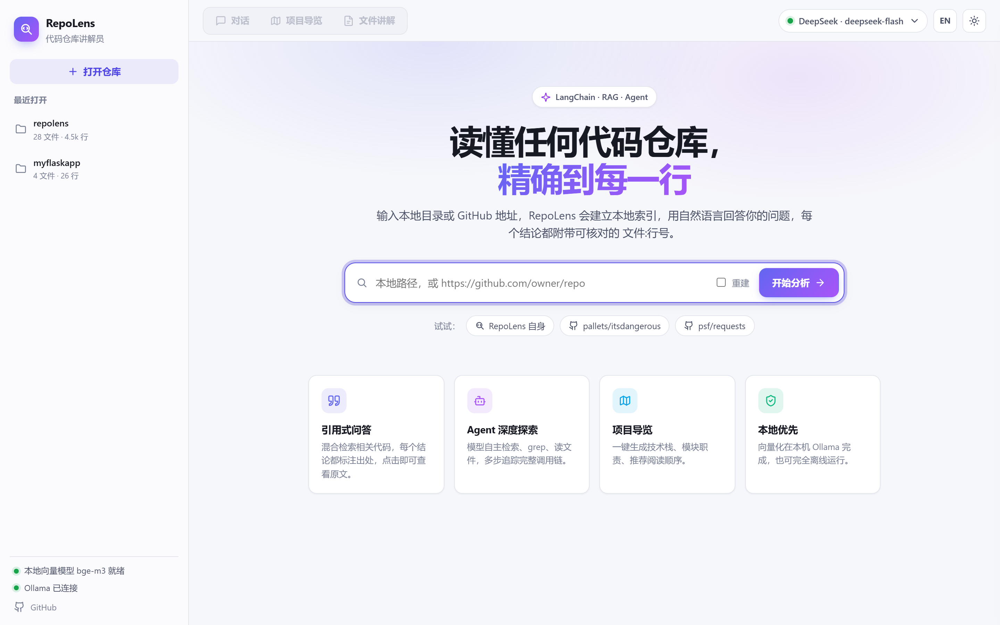
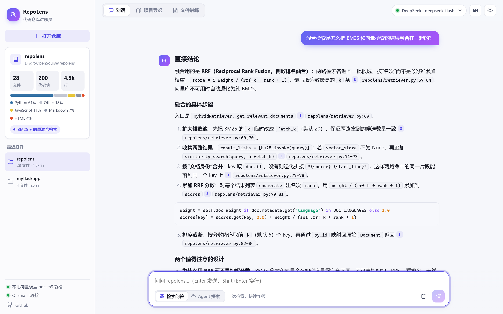
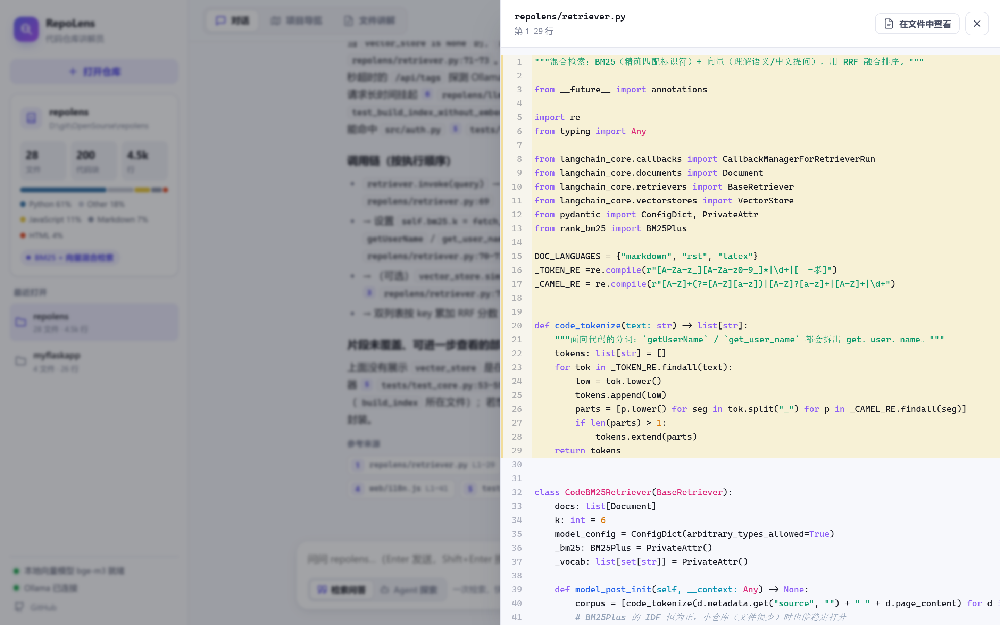
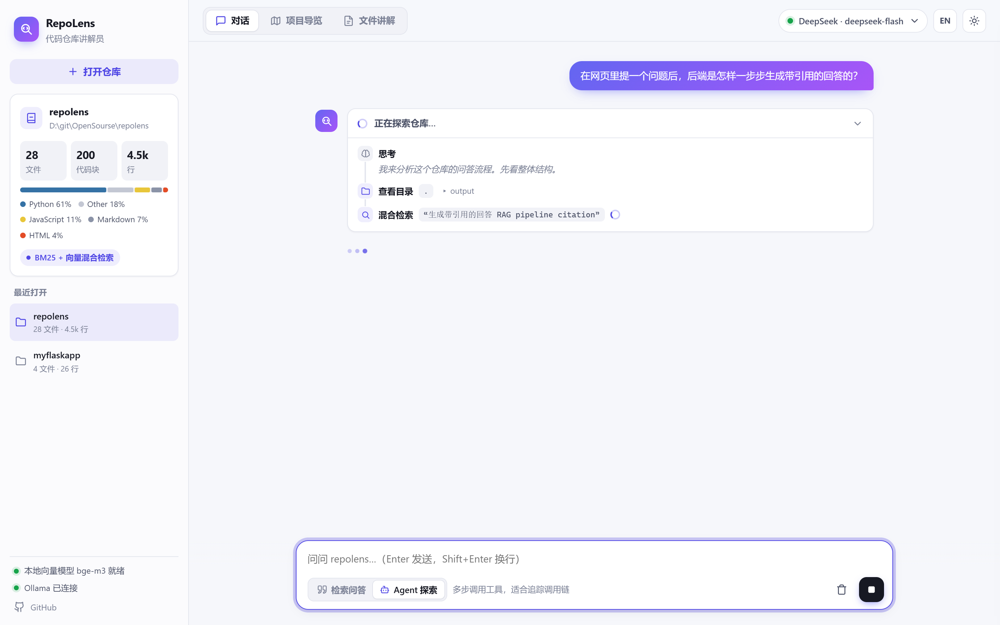
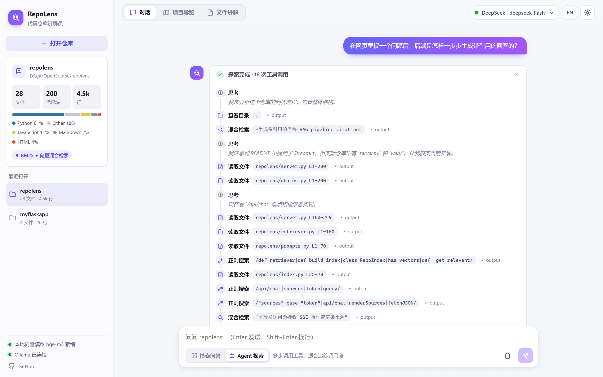
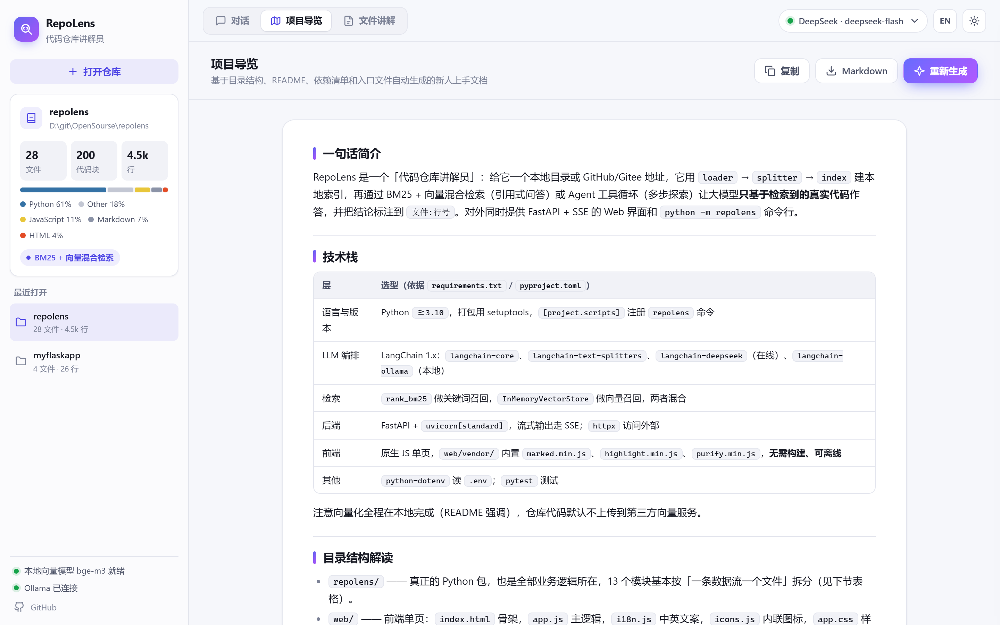
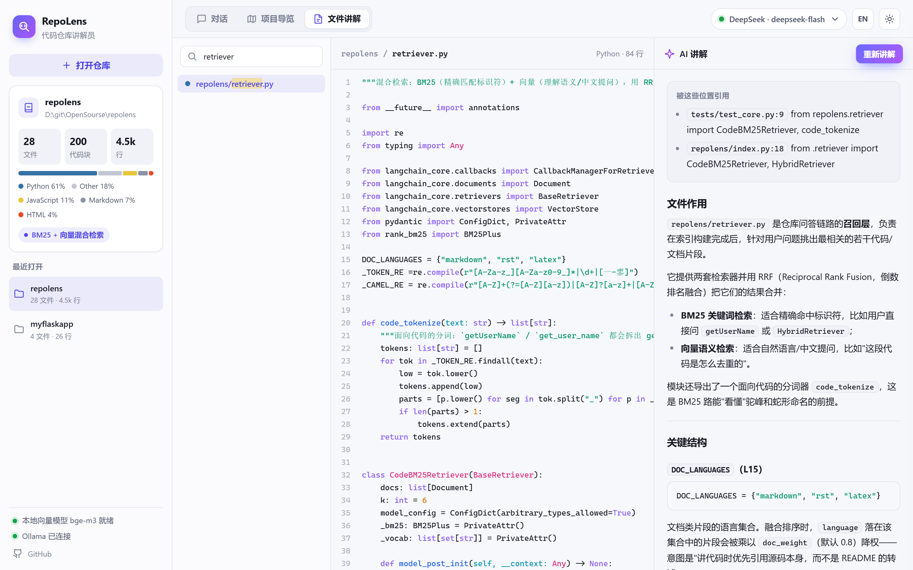
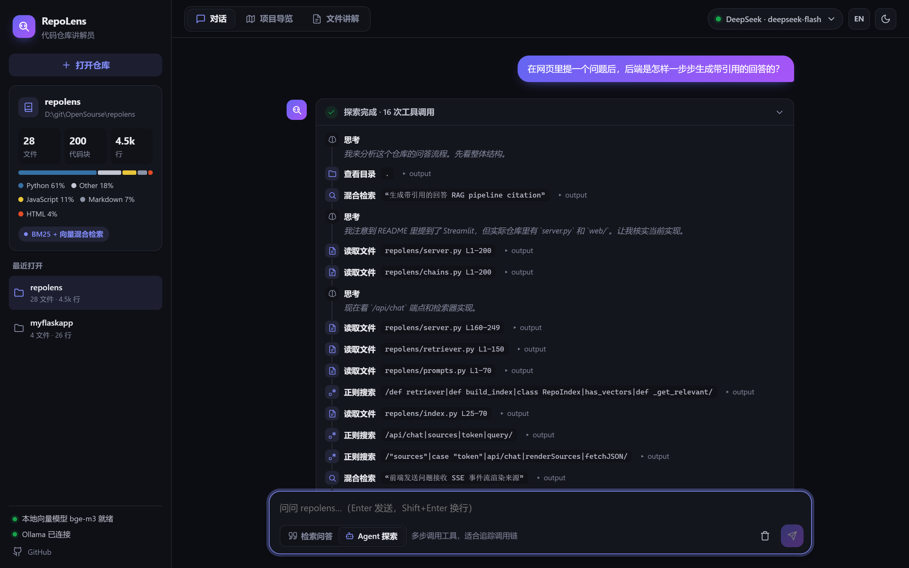
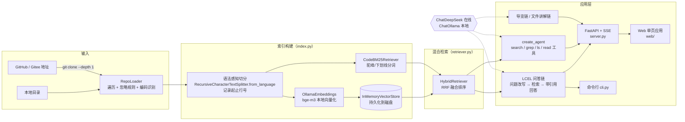

<div align="center">

# 🔭 RepoLens · 代码仓库讲解员

**丢给它一个本地目录或 GitHub 地址，它会读懂整个仓库，用自然语言回答你的问题，并精确到 `文件:行号`。**

基于 **LangChain 1.x** 构建 · 在线 **DeepSeek** / 本地 **Ollama** 一键切换 · 中英双语界面 · 代码向量化全程本地完成


**简体中文** | [English](README.en.md)



</div>

---

## 📌 目录

- [为什么做这个项目](#-为什么做这个项目)
- [功能一览](#-功能一览)
- [效果演示](#-效果演示)
- [系统架构](#-系统架构)
- [LangChain 组件使用说明](#-langchain-组件使用说明)
- [快速开始](#-快速开始)
- [使用方式](#-使用方式)
- [项目结构](#-项目结构)
- [关键设计与实现细节](#-关键设计与实现细节)
- [测试](#-测试)
- [局限与后续计划](#-局限与后续计划)

## 💡 为什么做这个项目

刚加入一个团队、接手一个开源项目或者阅读课程大作业的代码时，最痛苦的往往不是写代码，而是**读懂别人的代码**：

- 不知道入口在哪里、模块之间怎么调用；
- 想找“登录逻辑在哪”只能全局搜索，一个个文件翻；
- 直接把代码贴给 ChatGPT？仓库太大贴不下，而且模型容易**编造不存在的代码**。

RepoLens 用 **RAG（检索增强生成）+ Agent** 解决这个问题：先把仓库按语法结构切块、建立本地索引，再让大模型**只基于检索到的真实代码**作答，并给出可点击核对的出处。

## ✨ 功能一览

| 功能 | 说明 |
| --- | --- |
| 💬 **引用式问答** | BM25 + 向量混合检索最相关的代码片段，回答中的 `[编号]` 和 `路径:行号` 都可以点击，侧边抽屉直接打开源码并高亮对应行；支持多轮追问（自动改写问题） |
| 🤖 **Agent 深度探索** | 大模型自主调用 `search_code` / `grep_code` / `list_directory` / `read_file` 四个工具，多步追踪调用链；界面以时间线实时展示每一步，最终回答逐字流式输出 |
| 🗺️ **项目导览** | 读取目录树、README、依赖清单和入口文件，一键生成技术栈、目录解读、模块职责表、启动方式、推荐阅读顺序，可复制或导出 Markdown |
| 📄 **文件讲解** | 可搜索的文件树 + 带语法高亮和行号的代码视图，逐函数讲解，并找出仓库中引用它的位置 |
| 🔀 **在线 / 离线双模式** | 在线 DeepSeek（效果好、速度快）与本地 Ollama（完全离线、隐私安全）随时切换 |
| 🌐 **中英双语 · 明暗主题** | 界面与模型回答语言一键切换；亮色 / 暗色主题；对话、导览、讲解结果自动保存在浏览器 |
| ⚡ **增量缓存** | 基于文件指纹缓存索引，仓库未变化时秒级加载；GitHub / Gitee 仓库自动浅克隆；最近打开的仓库一键切换 |
| 🖥️ **Web + CLI** | FastAPI + SSE 流式后端与原生 JS 单页前端（无需构建，依赖库已内置，离线可用），以及 `python -m repolens` 命令行工具 |

## 🎬 效果演示

> 以下截图由 [`scripts/screenshots.py`](scripts/screenshots.py) 用 Playwright 驱动真实浏览器自动生成：RepoLens 讲解它自己的源码，对话模型为 DeepSeek，向量模型为本地 Ollama `bge-m3`。

**💬 引用式问答**：回答中的 `[编号]`、`路径:行号` 和下方的来源卡片都可以点击。



**📎 点击引用**：侧边抽屉打开源码，高亮被引用的行，还可以跳转到文件讲解页。



**🤖 Agent 探索**：时间线展示每一次工具调用，点击可查看工具输出，`read_file` 的参数可直接打开对应代码。

| 探索中（实时） | 探索完成 |
| --- | --- |
|  |  |

**🗺️ 项目导览** 与 **📄 文件讲解**

| 项目导览 | 文件讲解 |
| --- | --- |
|  |  |

**🌙 暗色主题**



## 🏗️ 系统架构



**一次问答的执行流程：**

```
用户提问 ──► (有历史) 改写成独立问题 ──► BM25 Top20 ┐
                                       向量 Top20 ┴─► RRF 融合取 Top6（文档类片段适当降权）
         ──► 格式化为 “[n] 路径 (Lx-Ly) + 代码” ──► QA Prompt ──► LLM 流式输出
         ──► SSE 事件：query → sources → token… → done ──► 前端渲染回答、引用标记与来源卡片
```

## 🦜 LangChain 组件使用说明

| LangChain 能力 | 在本项目中的使用 | 位置 |
| --- | --- | --- |
| `Document` | 统一承载文件内容与元数据（路径、语言、起止行号） | `loader.py` |
| `RecursiveCharacterTextSplitter.from_language` | 按 Python / JS / Go / Java 等 20+ 种语言的类、函数边界切分 | `splitter.py` |
| `Embeddings`（`OllamaEmbeddings`） | 本地 bge-m3 向量化，源码不出本机 | `llm.py` |
| `InMemoryVectorStore` | 向量存储，`dump/load` 持久化到磁盘 | `index.py` |
| 自定义 `BaseRetriever` | `CodeBM25Retriever`（代码分词 BM25）+ `HybridRetriever`（RRF 融合） | `retriever.py` |
| `ChatPromptTemplate` + `MessagesPlaceholder` | 问答、问题改写、导览、文件讲解的提示词模板，中英文各一套，支持多轮历史 | `prompts.py` |
| **LCEL**（`prompt \| llm \| parser`） | 四条链的组合与 `.stream()` 流式输出 | `chains.py` |
| `ChatDeepSeek` / `ChatOllama` | 在线与本地模型的统一接口，按请求切换 | `llm.py` |
| `@tool` | 四个仓库探索工具，带路径越界防护 | `agent.py` |
| `create_agent`（LangChain 1.x，基于 LangGraph） | ReAct 式工具调用 Agent；同时订阅 `messages` 与 `updates` 两种流，既实时展示工具调用，又逐字输出回答 | `agent.py` |
| `FakeListChatModel` / `DeterministicFakeEmbedding` | 单元测试中替代真实模型，测试无需联网 | `tests/` |

## 🚀 快速开始

### 1. 环境要求

- Python 3.10+
- Git（用于克隆远程仓库）
- [Ollama](https://ollama.com/)（用于本地向量化；可选，缺失时自动降级为纯 BM25 检索）
- DeepSeek API Key（使用在线模型时需要，[在这里申请](https://platform.deepseek.com/api_keys)）

### 2. 安装

```bash
git clone https://github.com/Red-Sa1t/repolens.git
cd repolens
python -m venv .venv
# Windows
.venv\Scripts\activate
# macOS / Linux
source .venv/bin/activate
pip install -r requirements.txt
```

### 3. 准备模型

```bash
# 本地向量模型（中英文 + 代码效果都不错，约 1.2GB）
ollama pull bge-m3

# 如果想完全离线对话，再拉一个支持工具调用的对话模型
ollama pull qwen2.5:7b
```

### 4. 配置

```bash
cp .env.example .env
```

编辑 `.env`，填入 `DEEPSEEK_API_KEY`。也可以不写 `.env`，在网页右上角的模型设置中填写（只保存在本机浏览器）。

| 变量 | 默认值 | 说明 |
| --- | --- | --- |
| `REPOLENS_PROVIDER` | `deepseek` | 默认对话模型来源：`deepseek` / `ollama` |
| `DEEPSEEK_API_KEY` | — | DeepSeek 密钥 |
| `DEEPSEEK_MODEL` | `deepseek-chat` | 也可用 `deepseek-reasoner` 等 |
| `OLLAMA_BASE_URL` | `http://localhost:11434` | Ollama 服务地址 |
| `OLLAMA_MODEL` | `llama3.2` | 本地对话模型 |
| `REPOLENS_EMBED_MODEL` | `bge-m3` | 本地向量模型 |

### 5. 启动

```bash
python -m repolens serve
```

浏览器打开 <http://127.0.0.1:8000>，输入仓库路径或 GitHub 地址，点击 **开始分析**。没有现成仓库？点 **RepoLens 自身**，让它讲解自己。

## 🧭 使用方式

### Web 界面

- **对话**：输入框下方切换「检索问答」与「Agent 探索」。
  - 检索问答适合“X 在哪 / X 是什么”，一次检索、几秒出结果；
  - Agent 探索适合“完整调用链 / 要改某功能需要动哪些文件”，模型会自己多次检索和读文件。
  - 点击回答里的 `[1]`、`路径:行号` 或来源卡片，右侧抽屉会打开源码并高亮对应行。
  - `Enter` 发送，`Shift+Enter` 换行，生成过程中可随时点击停止。
- **项目导览**：点击「生成导览」，结果可复制或导出 Markdown。
- **文件讲解**：左侧搜索并选择文件，中间是高亮源码，右侧点击「讲解此文件」。
- **右上角**：切换模型（DeepSeek / Ollama）、界面语言（中 / EN，模型回答语言随之切换）、明暗主题。

### 命令行

```bash
# 构建 / 刷新索引
python -m repolens index ./some-project

# 提问（检索问答）；--lang en 用英文回答
python -m repolens ask ./some-project "用户登录的逻辑在哪里？"

# Agent 模式提问
python -m repolens ask https://github.com/pallets/flask "一个请求从进入到返回经历了哪些函数？" --agent

# 生成项目导览 / 讲解文件
python -m repolens overview ./some-project
python -m repolens explain ./some-project src/app.py

# 交互式多轮对话；--provider 临时切换模型
python -m repolens --provider ollama --model qwen2.5:7b chat ./some-project
```

## 📁 项目结构

```
repolens/
├── repolens/
│   ├── config.py          # 配置（.env → Settings）
│   ├── llm.py             # 模型工厂：ChatDeepSeek / ChatOllama / OllamaEmbeddings
│   ├── loader.py          # 仓库加载：本地/远程、忽略规则、编码识别、目录树
│   ├── splitter.py        # 语法感知切分 + 行号追踪
│   ├── retriever.py       # 代码 BM25 检索器 + RRF 混合检索器
│   ├── index.py           # 索引构建、指纹缓存、持久化
│   ├── prompts.py         # 中英文提示词模板
│   ├── chains.py          # LCEL 链：问答 / 导览 / 文件讲解
│   ├── agent.py           # 工具定义 + create_agent（逐 token 流式）
│   ├── server.py          # FastAPI 后端：REST + SSE 流式接口
│   └── cli.py             # 命令行入口（含 serve）
├── web/                   # 前端单页应用（无需构建）
│   ├── index.html
│   ├── app.css            # 设计令牌 + 明暗主题
│   ├── app.js             # 视图、流式渲染、引用跳转、文件树
│   ├── i18n.js            # 中英文界面文案
│   ├── icons.js           # 线性图标
│   └── vendor/            # marked / DOMPurify / highlight.js（本地内置，离线可用）
├── scripts/screenshots.py # Playwright 自动截图
├── tests/                 # pytest：核心模块 + API 接口（不依赖网络和真实模型）
├── docs/images/           # README 截图（zh / en）
├── requirements.txt
└── .env.example
```

**后端接口一览：**

| 接口 | 说明 |
| --- | --- |
| `GET /api/settings` | 当前模型配置、Ollama 与向量模型状态 |
| `GET /api/recent` | 最近打开的仓库 |
| `POST /api/index` | 构建 / 加载索引（SSE：`progress` → `repo`） |
| `GET /api/repos/{id}` / `GET /api/repos/{id}/file` | 仓库信息与文件列表 / 读取文件（带路径越界检查） |
| `POST /api/chat` | 问答（SSE：`query`、`sources`、`token`；Agent 模式另有 `tool_call`、`tool_result`、`answer`） |
| `POST /api/overview` / `POST /api/explain` | 项目导览 / 文件讲解（SSE：`token`，讲解另有 `references`） |

## 🔬 关键设计与实现细节

**1. 为什么用混合检索，而不是只用向量？**
代码检索有两类需求：用户用中文描述功能（“处理支付回调的地方”），这需要**语义检索**；用户直接问标识符（`check_password`），这时向量模型反而不如**关键词匹配**准。RepoLens 同时跑两路，再用 **RRF（Reciprocal Rank Fusion）** 按排名融合，不需要调两路分数的权重。README 等文档片段在融合时乘以 0.8 的权重，讲解代码时优先引用源码本身。

**2. 面向代码的分词。**
BM25 分词时把 `getUserName`、`get_user_name` 拆成 `get / user / name` 并保留整体，这样搜“user name”也能命中驼峰命名的函数。使用 `BM25Plus` 而不是 `BM25Okapi`，避免文件很少的小仓库出现 IDF 为 0、什么都搜不到的问题。

**3. 精确到行号、可点击的引用。**
切分时开启 `add_start_index`，再根据字符偏移换算出每个代码块的起止行号。前端把回答中的 `[编号]` 和形如 `路径:行号` 的内联代码识别出来，映射到仓库中的真实文件，点击即在抽屉中打开源码并高亮对应行。

**4. 流式体验。**
后端所有生成接口都是 SSE 事件流；前端用 `requestAnimationFrame` 合并渲染，避免每个 token 都重排页面。Agent 模式同时订阅 LangGraph 的 `messages`（逐 token）和 `updates`（工具调用）两种流：工具调用前模型说的话归入“思考”步骤，最终回答逐字输出。

**5. 隐私与离线。**
向量化固定走本地 Ollama，**完整源码不会发给任何向量服务**；只有检索到的少量片段会发给对话模型。前端依赖库全部内置在 `web/vendor/`，不依赖 CDN。如果对话模型也选 Ollama，整个流程完全离线。

**6. Agent 的安全边界。**
`read_file` / `list_directory` 和文件读取接口都会把路径解析后检查是否仍在仓库根目录内，阻止 `../../etc/passwd` 这类越权读取；工具输出有长度上限，Agent 有最大步数（`recursion_limit`），防止上下文爆炸和死循环。

**7. 增量缓存与优雅降级。**
指纹由“文件相对路径 + 大小 + 修改时间 + 向量模型名 + 切分参数”计算，仓库没有变化时直接加载缓存。Ollama 未启动或没有拉取向量模型时（先用带超时的接口探测，避免请求挂起），自动降级为纯 BM25 检索，界面上会提示当前检索模式。后端重启后，前端会自动用缓存重新加载仓库并重试请求。

## 🧪 测试

```bash
pytest -q
```

测试使用 LangChain 自带的 `FakeListChatModel` 和 `DeterministicFakeEmbedding`，**不需要网络和 API Key**，共 16 个用例，覆盖：

- 代码分词、远程地址识别、忽略规则（`node_modules`、二进制文件、`.gitignore`）
- 切分后的行号是否准确
- 索引构建、缓存命中、文件变动后自动重建、无向量模型时降级
- Agent 四个工具的输出，以及路径越界防护
- 问答链端到端调用与引用位置查找
- FastAPI 接口：索引进度事件、文件读取与越界拦截、问答 / 导览 / 讲解的 SSE 事件流、静态前端

## 🧱 局限与后续计划

- [ ] 超大仓库（> 3000 个文件）目前只索引前 3000 个文件，后续可按目录选择性索引
- [ ] 用 tree-sitter 解析符号表，支持“跳转到定义 / 查找所有调用”
- [ ] 生成模块依赖关系图（Mermaid）
- [ ] 接入 Chroma / Milvus 等持久化向量库，支持多仓库联合检索
- [ ] 本地小模型（如 3B 以下）在 Agent 模式下规划能力有限，推荐使用 DeepSeek 或 7B 以上的 Qwen2.5

## 📄 License

[MIT](LICENSE)
